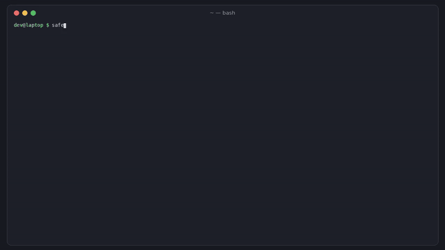

# safeclone

[](https://github.com/hamarshehmhmd/safeclone/actions/workflows/ci.yml)
[](LICENSE)


**Open stranger repos without handing over your laptop.** Interview take-homes, exploit PoCs, "can you review my project?" zips: `safeclone` lists every place the repo can run code by itself (git hooks and config, VS Code folder-open tasks, devcontainer hooks, npm/Python install hooks, agent hooks, hidden code), moves those files to a quarantine folder so your editor can't run them, and runs `npm install` and friends in a credential-free sandbox with decoy keys that show you what the code tried to steal.



```sh
curl -fsSL https://raw.githubusercontent.com/hamarshehmhmd/safeclone/main/install.sh | sh
```

Please [read `install.sh`](install.sh) before piping it to a shell. (It installs with `uv tool`, `pipx`, or a private venv. Or run `pipx install git+https://github.com/hamarshehmhmd/safeclone`.)

## The problem

Now the repo itself is the attack, often before any package is installed:

- **Binance's $6.3B heist (Nov 2026)** started when an engineer ran a fake-interview "assignment" on his work Mac. It swapped in a trojaned `pyenv`, and EDR didn't catch it ([HN, 655 pts](https://news.ycombinator.com/item?id=50365755), [The Register](https://www.theregister.com/security/2026/11/03/north-korean-fake-job-interview-led-to-63b-binance-heist/5307398)).
- **"I inspected my take-home interview project. It was a whole operation"**: the zip shipped with every `.git` hook already filled in with `curl | sh`, and the task PDF told candidates to run git commands ([HN, 482 pts](https://news.ycombinator.com/item?id=49013036)).
- **VS Code `tasks.json` with `"runOn": "folderOpen"`** and hidden output, pulling typosquatted npm packages ([Abstract Security](https://www.abstract.security/blog/contagious-interview-tracking-the-vs-code-tasks-infection-vector), [Microsoft](https://www.microsoft.com/en-us/security/blog/2026/03/11/contagious-interview-malware-delivered-through-fake-developer-job-interviews/)).
- Socket tracks 1,700+ "Contagious Interview" packages across five ecosystems, and JPCERT/CC publishes new IoCs almost every day ([JPCERTCC/Contagious-Interview-IoCs](https://github.com/JPCERTCC/Contagious-Interview-IoCs)).

Workspace Trust is one click away from "Trust". Dev Containers forward your git credentials and SSH agent by default. Registry firewalls see packages, not `.git/config` or `tasks.json`.

## What it does

| Command | What happens | Runs repo code? |
|---|---|---|
| `safeclone scan <git-url\|zip\|tar\|dir>` | Fetches safely and lists every auto-exec surface + content red flag. Exit 1 at `--fail-on` (default `high`). | No |
| `safeclone open <target>` | Copies into `~/safeclone/<name>`, scans, then **defuses**: moves hooks/tasks/etc. to `.safeclone/quarantine/`, strips dangerous `.git/config` keys, writes `ignore-scripts=true` and `task.allowAutomaticTasks: off`. | No |
| `safeclone run <target> -- <cmd>` | Runs `<cmd>` on a **copy** in a bubblewrap sandbox: empty `$HOME` with decoy credentials, no SSH agent, no host env/tokens, no network (HTTP(S) proxy sinkhole logs where it tried to go), optional `strace` of every `execve`/`connect`. | Yes, sandboxed (Linux) |

**Safe fetching.** Git clones run with hooks, fsmonitor, symlinks, LFS smudge, credential helpers and the `file`/`ext` protocols turned off, and without your SSH agent. Archives are extracted without path traversal or symlinks (each one is reported). The `.git/` folder shipped inside a zip is kept, because that's where the traps are.

**Surfaces checked**

- **git**: non-sample hooks in `.git/hooks`; `.git/config` keys that run programs (`core.fsmonitor`, `core.hooksPath`, `core.sshCommand`, `core.pager/editor`, filter/diff/merge drivers, `credential.helper`, `include.path`, `!` aliases); `.git` gitdir redirects; `.husky/` hooks
- **VS Code & forks** (Cursor, Windsurf, VSCodium): `tasks.json` folder-open tasks (and hidden presentation), settings that make the editor run a binary from the repo (`python.defaultInterpreterPath`, `git.path`, `terminal.integrated.*`, `*.executablePath`…), `task.allowAutomaticTasks: on`, `launch.json` preLaunchTask
- **Dev Containers**: `initializeCommand` (runs on the **host**), post-create hooks, mounts of `~/.ssh`, `docker.sock`, privileged
- **npm/yarn/pnpm**: install lifecycle scripts, `pre*` run hooks, URL/git dependencies, `.npmrc` `script-shell`/`node-options`, `.yarnrc.yml` `yarnPath`, `.pnpmfile.cjs`
- **Python**: `setup.py`, in-tree build backends (`backend-path`), `.pth` / `sitecustomize.py`
- **direnv** `.envrc`; **coding agents**: `.claude/settings*.json` hooks, `.mcp.json`, `.cursor/hooks.json`, `.gemini/settings.json`, `.codex/config.toml`
- **content**: `curl | sh`, PowerShell download-exec, `eval(atob(…))`, `new Function(…)`, remote eval, reverse shells, paste/JSON-bin payload hosts (npoint, jsonkeeper…), bare-IP URLs, references to SSH keys/browser profiles/wallet extensions, code hidden far right after whitespace, invisible/bidi Unicode, obfuscated lines, prebuilt native binaries, symlinks out of the repo
- **IoCs**: a tiny built-in list plus your own via `--ioc-file` (one package name, domain or string per line, e.g. exported from the JPCERT/CC feed)

## Usage

```sh
# 1. Look before you touch: nothing is executed
safeclone scan https://github.com/someone/take-home-assignment
safeclone scan ~/Downloads/assessment.zip --json > report.json
safeclone scan . --sarif safeclone.sarif --fail-on medium     # CI / pre-review gate

# 2. Get a copy you can open in your editor
safeclone open ~/Downloads/assessment.zip        # -> ~/safeclone/assessment
code ~/safeclone/assessment                      # folder-open tasks were quarantined

# 3. Need to install/run it? Do it in the sandbox, offline, against decoys
safeclone run ~/safeclone/assessment -- npm install
safeclone run ~/safeclone/assessment --fail-on-suspicious -- npm test
safeclone run ./poc --net --ro ~/.nvm -- node exploit.js   # allow network / expose a toolchain read-only
```

Example `run` output on the bundled inert take-home (`python examples/make_takehome.py`):

```
safeclone run: npm run postinstall
sandbox: no host HOME, no SSH agent, no tokens, network: none (loopback only; HTTP(S) proxy sinkhole)
exit code: 0  (0.5s)
touched decoy credentials:
  read      ~/.ssh/id_rsa
  read      ~/.aws/credentials
tried to reach non-registry hosts (blocked by sinkhole):
  POST    http://203.0.113.7:1224/uploads
  CONNECT api.npoint.io:443
package registry requests (expected, blocked offline): 1 to registry.npmjs.org
files: 0 created, 0 modified, 0 deleted in the copy
verdict: SUSPICIOUS
```

The sandbox's decoys are fake SSH keys, AWS/gh/docker/kube credentials, `.git-credentials`, shell history, a `.env`, Solana/Exodus/Electrum wallet files, and a Chrome profile with a MetaMask extension folder. A read is detected from the file's access time. The report comes back on a pipe the sandboxed command never gets, and the supervisor marks itself non-dumpable. Treat this as best-effort hardening, not a guarantee.

## Demo

[`demo.mp4`](https://github.com/hamarshehmhmd/safeclone/releases/tag/v0.1.0) (about 2.5 min, narrated) walks through `scan`, `open` and `run` on [`examples/make_takehome.py`](examples/make_takehome.py). That script builds an **inert** imitation of a Contagious Interview take-home: hosts are RFC 5737 TEST-NET or `.invalid`, the hidden eval decodes to `console.log`, and its install script exits right away unless it is inside the safeclone sandbox. `demo/render.py` re-renders the video from real command output.

## Limits (read these)

- **Heuristics, not antivirus.** A determined attacker can evade static rules, so a clean scan is not a guarantee. Use `run` for anything you execute, and use a throwaway VM for anything you really don't trust.
- **`run` is Linux-only** (needs `bwrap`; on Ubuntu 24.04 you may need `sysctl kernel.apparmor_restrict_unprivileged_userns=0`). `scan` and `open` work on Linux and macOS (Windows is untested).
- Offline by default. Package installs that need the registry fail unless you pass `--net`, which also turns off the proxy sinkhole (use `strace` mode then to see `connect` calls). Traffic that ignores `HTTP(S)_PROXY` is still blocked offline, but it is only listed when `strace` is installed.
- The sandbox exposes system dirs (`/usr`, `/etc/ssl`, …) read-only, plus anything you pass with `--ro`. It does not expose your home directory.
- The IoC list is small on purpose. Feed it real intel with `--ioc-file`.

## Development

```sh
python -m pip install -e . pytest
python -m pytest -q            # sandbox tests auto-skip without bubblewrap
```

Zero runtime dependencies. Python 3.9+.

## License

GNU Affero General Public License v3.0 or later ([`LICENSE`](LICENSE)), SPDX `AGPL-3.0-or-later`.

**Commercial licenses** without the AGPL obligations (for example, to embed safeclone in a proprietary hiring platform or security product) are available from the author, Mohammad Hamarsheh. Open an issue or contact him through [GitHub](https://github.com/hamarshehmhmd).
